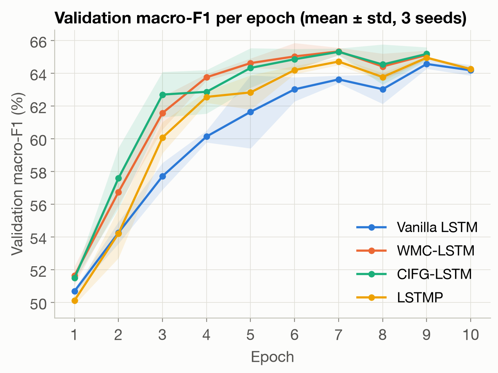
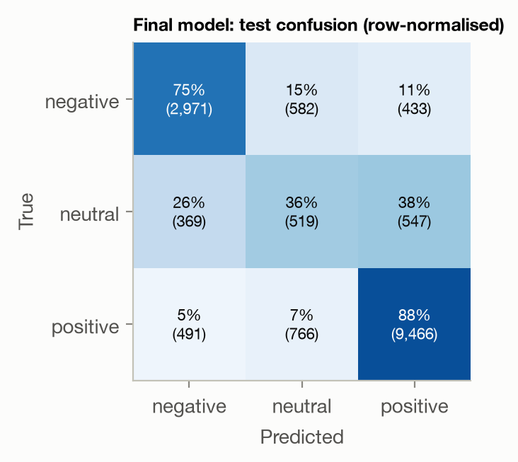

# LSTM variants for drug-review sentiment classification

Lab project — *Advanced Natural Language Processing*, 2026/2027.

**Team:** Anys Louzal ([@Anyslouzal](https://github.com/Anyslouzal)), Mohammed Yassine Ben Meziane ([@mohammedyassinebenmeziane](https://github.com/mohammedyassinebenmeziane)),
Salma Abarkane ([@salma-abarkane](https://github.com/salma-abarkane)),
Imad-Eddine El Khorassani ([@ImadEddineELkh](https://github.com/ImadEddineELkh)),
Faress Mohamed Anouar ([@Anouarfrs](https://github.com/Anouarfrs)).

We classify patient reviews from the [Drugs.com review dataset](https://archive.ics.uci.edu/dataset/462/drug+review+dataset+drugs+com)
(UCI, Gräßer et al. 2018) into **negative / neutral / positive** sentiment and compare four LSTM cells,
all implemented from scratch with `nn.Linear` (no `nn.LSTM`):

| Cell | Idea | Reference |
|---|---|---|
| **Vanilla LSTM** (baseline) | input, forget, output gates + candidate | Hochreiter & Schmidhuber, 1997 |
| **WMC** — Working Memory Connections | gates also read the cell state through `tanh(W_c c)` | Landi et al., 2021 |
| **CIFG** — Coupled Input-Forget Gate | `i_t = 1 - f_t` (one gate fewer) | Greff et al., 2017 |
| **LSTMP** — LSTM with projection | the hidden state is a projection `h_t = W_p m_t + b_p` with `P < H` | Sak et al., 2014 |

## Results

Test set: the official test split after removing duplicates and reviews already present in training
(16,144 reviews). Main metric: macro-F1 (classes are 66 % positive / 25 % negative / 9 % neutral).

| Model | Recurrent params | Test macro-F1 | Test accuracy |
|---|--:|--:|--:|
| Vanilla LSTM, H = 256 (baseline) | 394k | 63.99 ± 0.37 | 78.9 |
| WMC, H = 256 | 591k | 64.50 ± 0.25 | 79.8 |
| CIFG, H = 256 | 296k | 64.51 ± 0.21 | 78.7 |
| LSTMP, H = 256, P = 128 | 296k | 64.26 ± 0.27 | 79.1 |
| **Final model: bidirectional 2-layer CIFG** (selected on validation) | 1.77M | **65.63** | **80.3** |

Mean ± std over 3 seeds; full tables in [`results/`](results/) and every run in `runs/<group>/<name>/results.json`.

* **Data leakage**: 30 % of training reviews are duplicates and 60 % of the official test reviews appear in training;
  we remove them before anything else.
* **Cells**: all four cells are within one point. WMC and CIFG are consistently better than the vanilla cell and
  learn faster (62 % validation macro-F1 after ~3.5 epochs vs 5.3). At an **equal budget of ≈296k recurrent
  parameters** the gap is significant: WMC +0.85 (p = 0.02), CIFG +0.73 (p = 0.03) — structure, not capacity.
* **Hyper-parameters** (vanilla, one factor at a time): learning rate and optimizer dominate
  (Adam/AdamW, lr 1e-3–3e-3); Xavier init and batch 32–64 each add about one point.
* **Final model**: CIFG read in both directions, 2 layers, Xavier init, Adam lr 2e-3 → 65.6 % macro-F1, 80.3 %
  accuracy; the neutral class (F1 31 %) remains the hardest.

<p align="center"> </p>

## Repository layout

```
src/
  cells.py      the four LSTM cells (nn.Linear only) + weight-initialisation schemes
  model.py      time unrolling with length masking, (bi)directional stacking, classifier
  data.py       cleaning, de-duplication, splits, vocabulary, length-bucketed batching
  train.py      training / evaluation of one configuration (CLI)
scripts/
  run_experiments.py   every experiment of the study (re-runnable, finished runs are skipped)
  eda.py               exploratory data analysis -> results/eda_stats.json, figures/eda_*.png
  analyze.py           aggregates runs/ -> results/*.csv, results/summary.json, figures/*.png
tests/test_cells.py    correctness tests (nn.LSTM used only as a reference oracle)
results/               aggregated metrics (CSV / JSON) of all runs
figures/               all figures of the report and slides
report/                report (report.pdf, report.docx; source report.md)
slides/deck/           presentation slides (one HTML file per slide, with speaker notes)
```

## Reproduce

```bash
pip install -r requirements.txt
# data: the original Drugs.com train/test split (UCI files, here as JSON lines from the Hugging Face mirror;
# official zip: https://archive.ics.uci.edu/ml/machine-learning-databases/00462/drugsCom_raw.zip)
mkdir -p data/raw
curl -L -o data/raw/train.jsonl https://huggingface.co/datasets/lewtun/drug-reviews/resolve/main/train.jsonl
curl -L -o data/raw/test.jsonl  https://huggingface.co/datasets/lewtun/drug-reviews/resolve/main/test.jsonl

python tests/test_cells.py                 # cells vs. PyTorch reference
python scripts/eda.py                      # exploratory analysis
python scripts/run_experiments.py --workers 3 --device mps   # or --device cuda / cpu
python scripts/analyze.py                  # tables + figures

# a single run
python src/train.py --cell wmc --hidden 256 --lr 1e-3 --batch-size 128 --group demo --name wmc_demo
```

Each run writes `runs/<group>/<name>/results.json` (config, parameter counts, per-epoch history,
validation and test metrics, confusion matrix) and the best checkpoint.

## Implementation notes

* **Only `nn.Linear` for the cells.** The four gate matrices acting on `x_t` are stored in one
  `nn.Linear(E, 4H)` (and those acting on `h_{t-1}` in one `nn.Linear(H, 4H, bias=False)`): it is the
  same parameterisation as the equations, computed with one matrix product. The input part `W_x x_t + b`
  is computed for all time steps at once before the recurrent loop.
* **Correctness.** `tests/test_cells.py` checks that our vanilla cell and LSTMP reproduce `nn.LSTMCell` /
  `nn.LSTM(proj_size=P)` exactly when given the same weights, that WMC reduces to the vanilla cell when
  `W_c = 0`, that CIFG keeps `c_t = c_{t-1}` when `f_t = 1`, and that padding does not change the result.
* **Variable lengths.** Past the end of a review the state is frozen, so the final hidden state is the one
  after the last real token (same result as packed sequences). Batches are bucketed by length.
* **Speed.** Unrolling with `unbind(1)` instead of indexing `x[:, t]` in the loop made the backward pass
  ~5x faster (slicing makes autograd materialise one full-size gradient per time step).
* **Data hygiene.** ~30 % of the training reviews are exact duplicates (the same review is listed under the
  brand and the generic drug name) and ~60 % of the official test reviews also appear in the training set.
  We de-duplicate and remove the overlap; otherwise test scores are inflated by memorisation.
