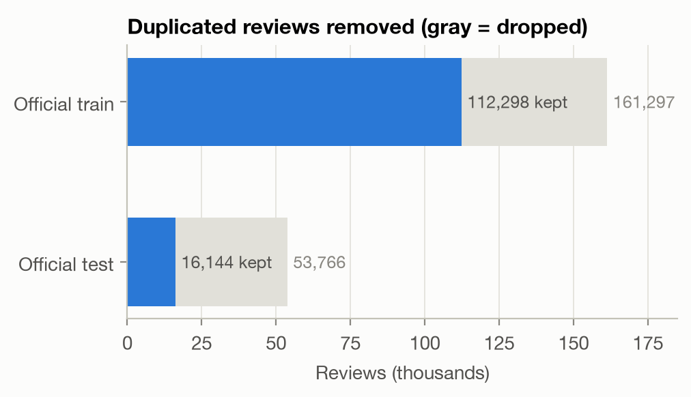
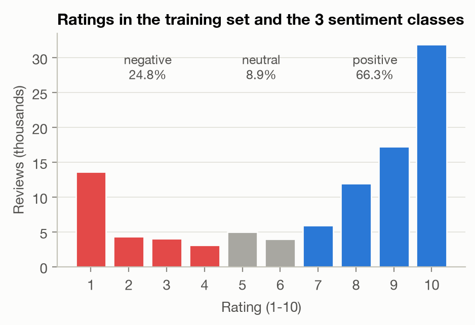
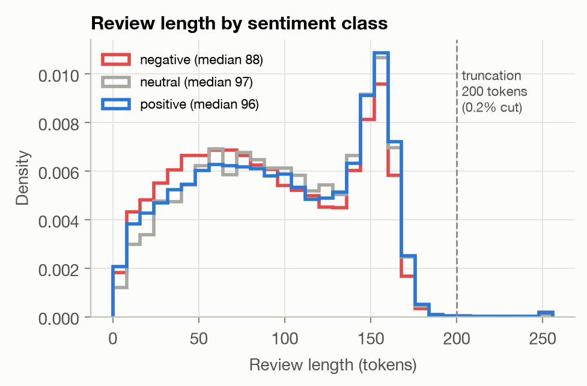
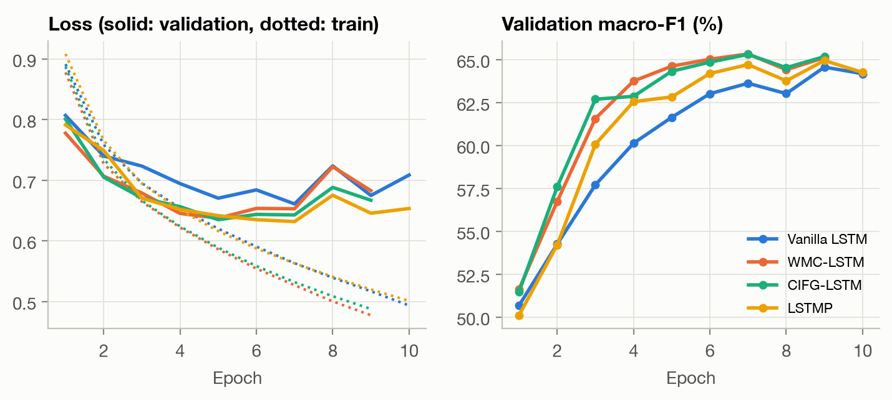
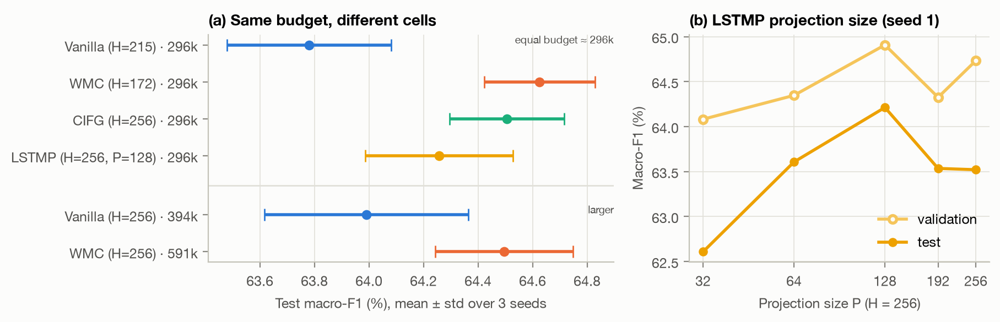
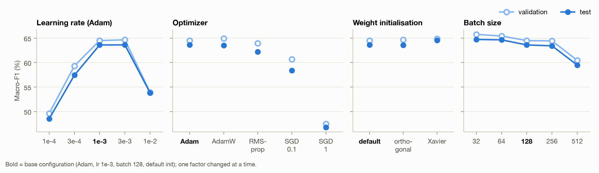

# 1. Goals of the task

Patients post free-text reviews of the drugs they take, together with a 1–10 satisfaction rating. We predict the
**sentiment** of a review from its text alone, in three classes following the dataset authors [1]: *negative*
(rating 1–4), *neutral* (5–6) and *positive* (7–10). This is useful for pharmacovigilance and to summarise patient
experience at scale. Our objectives are (i) to build a **vanilla LSTM** [5] baseline, (ii) to implement and compare
LSTM cells that are **not** vanilla — we implemented the three cells of the appendix: **Working Memory Connections
(WMC)** [2], the **Coupled Input-Forget Gate (CIFG)** [3] and the **LSTM with projection (LSTMP)** [4] — and
(iii) to study how training **hyper-parameters** (learning rate, optimizer, initialisation, batch size) affect them.
All cells are written from scratch with `nn.Linear`; `nn.LSTM` is never used in the models.

# 2. Exploratory data analysis

**Data and leakage.** The UCI *Drug Review (Drugs.com)* dataset has 161,297 training and 53,766 test reviews
(3,436 drugs, 884 conditions). Our first finding is a strong **duplication problem**: 48,968 training reviews (30 %)
are exact copies of another one — 99.97 % of the duplicate groups list the *same text under several drug names*
(brand and generic name of the same molecule), with the same rating in 99.9 % of cases. Worse, **32,216 test
reviews (60 %) also appear verbatim in the training set**. Keeping them would reward memorisation and inflate
test scores. We therefore keep a single copy of each review, drop test reviews seen in training, and carve a
stratified 10 % validation split out of the training set: **101,068 train / 11,230 validation / 16,144 test**
reviews (Fig. 1a). The three splits share the same class proportions.

<figure><figcaption>Fig. 1a — De-duplication and leakage removal.</figcaption></figure>
<figure><figcaption>Fig. 1b — Ratings and sentiment classes.</figcaption></figure>
<figure><figcaption>Fig. 1c — Review length by class.</figcaption></figure>

Figure 1 — Exploratory analysis of the training set.

**Class imbalance.** Ratings are polarised (Fig. 1b): 10/10 alone is 32 % of the reviews. After mapping, the classes
are **66.3 % positive, 24.8 % negative and only 8.9 % neutral**. A majority-class predictor reaches 66 % accuracy
but a macro-F1 of 0.27, so **macro-F1 is our main metric** and accuracy is reported as a secondary one.

**Length and vocabulary.** Reviews have 95 tokens on average (median 94, 99th percentile 173) with a peak around
150–160 tokens, the length limit of the website (Fig. 1c). We truncate at 200 tokens, which affects only 0.2 % of
the reviews. Negative reviews are slightly shorter (median 88 vs 96–97). Text is HTML-unescaped, lower-cased and
tokenised into words and punctuation; the vocabulary has 21,331 entries (words seen at least 3 times in training, plus padding and unknown)
(out-of-vocabulary rate: 0.5 % on test). A log-odds analysis [6] of the most class-specific words shows why the neutral
class is hard: positive reviews use *works, love, life, great, amazing, miracle*, negative ones *worse, worst,
horrible, terrible, stop, removed, reaction*, while neutral reviews are characterised by **contrast and hedging**
(*however, but, hoping, gained, tired*) — they mix positive and negative statements, so the model must weigh the
whole review rather than detect keywords. This is a natural test for the memory of an LSTM.

# 3. Modelling approach

**Cells.** Each cell computes the input part $W_{x\cdot}x_t+b_\cdot$ of all gates for all time steps with one
`nn.Linear` before the recurrent loop, then adds the recurrent part at each step (the gate matrices are stacked in one
`nn.Linear`, which is the same parameterisation as the appendix equations). The non-vanilla cells differ as follows:

* **WMC** lets the gates read the memory cell: $i_t=\sigma(W_{xi}x_t+W_{hi}h_{t-1}+\tanh(W_{ci}c_{t-1})+b_i)$, same for
  $f_t$, and the output gate sees the *updated* cell, $o_t=\sigma(\dots+\tanh(W_{co}c_t))$ — 3 extra $H\times H$ matrices.
* **CIFG** couples the input and forget gates, $i_t=1-f_t$: what is written is exactly what is forgotten; one gate
  (25 % of the recurrent weights) is removed.
* **LSTMP** keeps $H$ memory cells but exposes and feeds back a smaller projection $h_t=W_p\,(o_t\odot\tanh c_t)+b_p$,
  $h_t\in\mathbb{R}^P$, $P<H$: the recurrent matrices shrink from $4H\times H$ to $4H\times P$.

**Verification.** Unit tests check that, with the same weights, our vanilla cell and LSTMP reproduce PyTorch's
`nn.LSTMCell` and `nn.LSTM(proj_size=P)` to $10^{-6}$ (used only as an oracle), that WMC reduces to the vanilla cell
when $W_c=0$, that CIFG keeps $c_t=c_{t-1}$ when $f_t=1$, and that padding does not change the outputs.

**Classifier.** Token ids → embedding (dimension 128, trained from scratch) → dropout 0.3 → one recurrent layer →
hidden state after the **last real token** of the review (the state is frozen on padding, equivalent to packed
sequences) → dropout → linear layer → softmax over the 3 classes. Using the final state (rather than pooling over
time) makes the classifier rely on what the cell *remembers*, which is what we want to compare.

**Training protocol (identical for every model).** Same splits, same preprocessing and same evaluation. Cross-entropy
with class weights proportional to 1/√(class frequency) (a compromise between the imbalance and accuracy), Adam
(lr $10^{-3}$), batch size 128 with length bucketing, gradient-norm clipping at 1, at most 10 epochs with early
stopping (patience 3) on validation macro-F1; the best checkpoint is evaluated **once** on the test set. The
architecture comparison is repeated with **3 seeds** (mean ± std). Training ran on an Apple M4 GPU (PyTorch MPS);
experiments are logged as JSON per run and aggregated by a script (CSV tables and figures in the repository).

# 4. Results

## 4.1 Architecture comparison at equal width

Table 1 compares the four cells with $H=256$ ($P=128$ for LSTMP). The embedding (2.73 M parameters) dominates
the total size, so we report the **recurrent** parameters separately: they are what differs between cells.

| Cell | Recurrent params | Total params | Val. macro-F1 | **Test macro-F1** | Test acc. | F1 neg / neu / pos | Epochs to 62 % | s / epoch |
|:--|--:|--:|--:|--:|--:|:-:|--:|--:|
| Vanilla | 394,240 | 3,125,379 | 64.56 ± 0.36 | 63.99 ± 0.37 | 78.9 ± 1.5 | 75.1 / 28.6 / 88.2 | 5.3 | 113 |
| WMC | 590,848 | 3,321,987 | **65.60** ± 0.50 | 64.50 ± 0.25 | 79.8 ± 0.5 | 75.5 / 29.2 / 88.8 | 3.7 | 161 |
| CIFG | 295,680 | 3,026,819 | 65.59 ± 0.19 | **64.51** ± 0.21 | 78.7 ± 0.7 | 74.9 / **30.5** / 88.1 | **3.3** | **102** |
| LSTMP | 296,064 | 3,026,819 | 64.95 ± 0.11 | 64.26 ± 0.27 | 79.1 ± 1.5 | 75.1 / 29.2 / 88.5 | 4.0 | 128 |

Table 1 — Mean ± std over 3 seeds (%). "Epochs to 62 %": first epoch with validation macro-F1 ≥ 62 %.
Times measured with 3 runs sharing the GPU (relative values only).

<figure><figcaption>Figure 2 — Learning curves
(mean of 3 seeds). Left: training (dotted) and validation (solid) loss. Right: validation macro-F1.</figcaption></figure>

**All cells reach a similar level** — test macro-F1 between 64.0 and 64.5 % and accuracy 79–80 % — so the choice
of cell is not decisive on this task. The ranking is nevertheless consistent: **WMC and CIFG beat the vanilla
baseline by +1.0 point on validation** (Welch t-test, $p=0.05$ and $p=0.02$) and **+0.5 on test** ($p\approx0.13$
with only 3 seeds: a consistent trend, not a proof). LSTMP lies in between (+0.3 test). The clearest effect is on
**optimisation speed** (Fig. 2): CIFG reaches 62 % validation macro-F1 after 3.3 epochs and WMC after 3.7, against 5.3
for the vanilla cell. In CIFG the forget and input gates cannot both open, so each update of the memory is a convex
combination $c_t=f_tc_{t-1}+(1-f_t)g_t$ that keeps $c_t$ bounded and well conditioned; in WMC the gates see the
memory content directly and can react to it, which may also ease credit assignment. **CIFG gives the best
trade-off**: the (tied) best test score and the best neutral-class F1, with 25 % fewer recurrent parameters than the vanilla cell,
half those of WMC, and the fastest epochs. Training loss keeps decreasing while validation loss rises after
epoch 5–7 for every cell (Fig. 2, left): the models start to over-fit, which early stopping handles.

The **neutral class remains the bottleneck** (F1 ≈ 29–30 % against 75 % negative and 88 % positive): neutral reviews
mix praise and complaints (§2) and are 9 % of the data. The confusion matrix of the final model (§4.4) shows that
neutral reviews are confused in both directions.

## 4.2 Equal parameter budget and projection size

Since the cells differ in size, we also trained the vanilla cell with $H=215$ and WMC with $H=172$, so that all four
cells have ≈296k recurrent parameters — the size of CIFG-256 and LSTMP-256/128 (3 seeds each, Fig. 3a).

<figure><figcaption>Figure 3 — (a) Test macro-F1 of each
configuration (mean ± std, 3 seeds); the first four rows have the same recurrent budget. (b) LSTMP with H = 256 and a
varying projection size P (seed 1).</figcaption></figure>

**At equal budget the gap widens**: vanilla 63.78 ± 0.30, LSTMP 64.26 ± 0.27, CIFG 64.51 ± 0.21 and WMC 64.63 ± 0.20
test macro-F1. CIFG (+0.73, $p=0.03$) and WMC (+0.85, $p=0.02$) are now significantly better than the vanilla cell.
Shrinking WMC from 591k to 296k parameters does not hurt it (64.50 → 64.63), and enlarging the vanilla cell from 296k to
394k barely helps (63.78 → 63.99): **the improvement comes from the structure of the cell, not from its capacity.**
For LSTMP (Fig. 3b, one seed), test macro-F1 peaks at $P=128=H/2$ (64.2 %): a strong compression ($P=32$, 173k
parameters) costs 1.6 points, while $P=192$ or $P=256$ (no compression, 460k parameters) bring nothing (63.5 %). A
moderate projection acts as a useful bottleneck on the recurrent state.

## 4.3 Hyper-parameters

We varied one factor at a time around the base configuration of the vanilla model (Adam, lr $10^{-3}$, batch 128,
PyTorch default initialisation), seed 1 (Fig. 4).

<figure><figcaption>Figure 4 — Hyper-parameter study on the vanilla LSTM
(macro-F1, validation hollow / test filled). Bold tick = base configuration.</figcaption></figure>

* **Learning rate** is the most sensitive factor. $10^{-4}$ and $3\cdot10^{-4}$ are too slow to converge in 10 epochs
  (48.5 and 57.4 % test macro-F1), $10^{-2}$ is unstable (53.8 %), while $10^{-3}$ and $3\cdot10^{-3}$ tie (63.6 %) —
  the latter reaches its best validation score at epoch 5 instead of 9.
* **Optimizer.** Adaptive methods win: Adam (63.6) ≈ AdamW (63.5) > RMSprop (62.2), whose validation score peaks
  early and then oscillates. SGD with Nesterov momentum is far behind: too slow at lr 0.1 (58.4) and unstable at lr 1
  (46.8) despite gradient clipping. Per-parameter step sizes matter for LSTMs, whose gates receive gradients of very
  different scales.
* **Initialisation** changes less than one point: Xavier-uniform 64.6, orthogonal recurrent blocks 63.6, default
  63.6 (test). Orthogonal recurrent weights learn faster in the first epochs (62.9 vs 60.2 % validation at epoch 4) but
  end at the same level. These gaps are close to the seed noise (std ≈ 0.4), so we only retain Xavier as the best
  option on validation.
* **Batch size.** Smaller batches perform more updates per epoch: 32 and 64 gain ≈ 1 point (64.7 %) but are 3.3× and
  1.9× slower per epoch; 256 is equivalent to 128, and 512 performs too few updates in 10 epochs (59.5 %).

**Is the cell ranking an artefact of the learning rate?** We re-trained WMC and CIFG with lr $3\cdot10^{-4}$ and
$3\cdot10^{-3}$ (seed 1). At $3\cdot10^{-4}$ both are 1.3 points above the vanilla cell (58.7–58.8 vs 57.4 % test),
in line with their faster optimisation; at $3\cdot10^{-3}$ all three end at the same level (63.4–63.8 %). Taking for each
cell the learning rate that is best on validation ($3\cdot10^{-3}$ for vanilla, $10^{-3}$ for WMC and CIFG), the gated
cells keep their advantage (64.5–64.8 vs 63.6 % test): their benefit is largest when optimisation, rather than
capacity, is the bottleneck.

## 4.4 Final model

We combined the conclusions of the study: the **CIFG** cell (best trade-off), Xavier initialisation (best on
validation), Adam with lr $2\cdot10^{-3}$ (between the two best values), batch 128 (batch 64 was slightly better but
twice as slow), and we read the review **in both directions** (the backward pass is run on each review reversed
within its own length; the two final states are concatenated). Two candidates were trained for at most 12 epochs
and **chosen on validation only**; the selected model was then evaluated once on the test set.

| Candidate (CIFG, $H=256$ per direction) | Recurrent params | Val. macro-F1 | Test macro-F1 | Test acc. |
|:--|--:|--:|--:|--:|
| Vanilla baseline (§4.1, mean of 3 seeds) | 394k | 64.56 | 63.99 | 78.9 |
| Bidirectional, 1 layer | 591k | 65.64 | 65.09 | 79.7 |
| **Bidirectional, 2 layers (selected)** | 1.77M | **66.65** | **65.63** | **80.3** |

Table 2 — Final candidates. The 2-layer model reaches its best validation score at epoch 4
(70 min of training).

<figure style="flex:0.75"><figcaption>Figure 5 — Test confusion matrix of
the final model.</figcaption></figure>

The final model reaches **65.6 % test macro-F1 and 80.3 % accuracy**, +1.6 points of macro-F1 over the vanilla
baseline (per-class F1: negative 76.0, neutral 31.4, positive 89.4). Reading in both directions helps a
last-state classifier, because the backward state summarises the *beginning* of the review, which the forward state may
have partly forgotten after ~100 tokens; stacking a second layer adds another point on validation. Fig. 5 shows the remaining errors:
88 % of positive and 75 % of negative reviews are recognised, but only 36 % of neutral ones (26 % predicted negative,
38 % positive), and the class weights pull some clearly polar reviews towards *neutral* (precision of the neutral
class: 28 %). A 6/10 review such as “really helps with mood swings […] it also made me gain 50 lbs” is genuinely
ambiguous, and the boundary between 6 and 7 is subjective.

# 5. Discussion and potential improvements

**Take-aways.** (i) Cleaning the data mattered more than any architectural choice: 60 % of the official test set
was leaked. (ii) On this task all LSTM cells perform within one point; the non-vanilla cells are consistently better,
significantly so at equal parameter budget, and they **learn faster**. CIFG is our recommended cell: as accurate as WMC
with half its parameters, the cheapest per step and the most stable across seeds. (iii) The learning rate and the
optimizer dominate the other hyper-parameters; initialisation and batch size move results by about one point.
(iv) The neutral class is the main source of error.

**Limitations.** Three seeds give confidence intervals of about ±0.4 point, of the same order as the differences we
measure; the hyper-parameter study changes one factor at a time on the vanilla cell with one seed, so interactions
(e.g. learning rate × cell) are not explored; timings were measured with several runs sharing one GPU.

**Potential improvements.**

* **Better input representations**: pre-trained word vectors (fastText, or biomedical BioWordVec) and sub-word
  tokenisation would help with drug names, dosages and misspellings, which are frequent in patient reviews.
* **Better use of the hidden states**: attention pooling over all time steps instead of the last state, which
  should help long reviews whose sentiment is stated early.
* **Targeting the neutral class**: exploit the order of the labels (regress the 1–10 rating, or an ordinal loss),
  focal loss, or tune decision thresholds on the validation set to trade a little accuracy for macro-F1.
* **Side information**: the condition and the drug name are available for every review and could be embedded.
* **Training**: recurrent (variational) dropout and a learning-rate schedule (warm-up + cosine), since every model
  over-fits after 5–7 epochs; batch 64 gained one point at twice the cost.
* **Stronger baselines**: a fine-tuned Transformer (DistilBERT/BioBERT) as an upper bound, and a joint multi-seed
  search (e.g. Bayesian optimisation) over learning rate, batch size and cell.

# References

[1] F. Gräßer, S. Kallumadi, H. Malberg, S. Zaunseder. Aspect-based sentiment analysis of drug reviews applying
cross-domain and cross-data learning. *Proc. Int. Conf. on Digital Health*, 2018.

[2] F. Landi, L. Baraldi, M. Cornia, R. Cucchiara. Working Memory Connections for LSTM. *Neural Networks* 144, 2021.

[3] K. Greff, R. K. Srivastava, J. Koutník, B. R. Steunebrink, J. Schmidhuber. LSTM: A Search Space Odyssey.
*IEEE Trans. Neural Networks and Learning Systems* 28(10), 2017.

[4] H. Sak, A. Senior, F. Beaufays. Long Short-Term Memory Recurrent Neural Network Architectures for Large Scale
Acoustic Modeling. *Interspeech*, 2014.

[5] S. Hochreiter, J. Schmidhuber. Long Short-Term Memory. *Neural Computation* 9(8), 1997.

[6] B. L. Monroe, M. P. Colaresi, K. M. Quinn. Fightin' Words: Lexical Feature Selection and Evaluation for
Identifying the Content of Political Conflict. *Political Analysis* 16(4), 2008.

